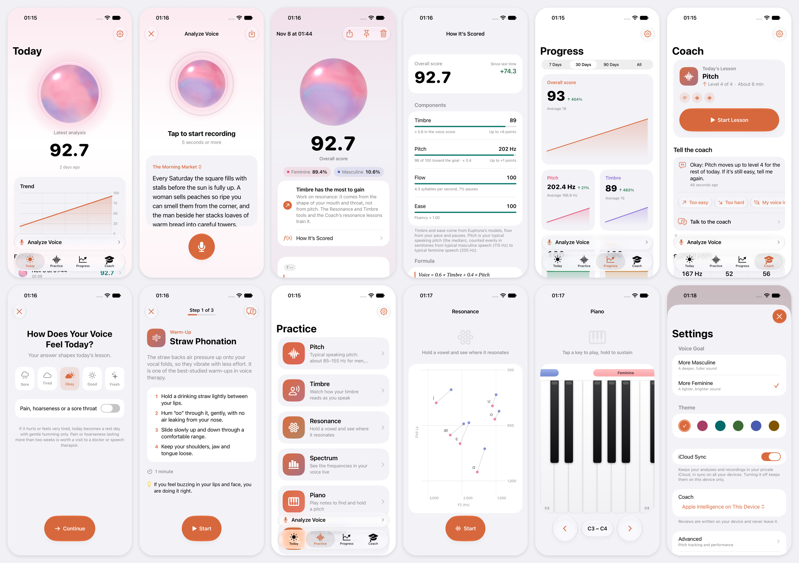

# Euphona

**Voice training for iPhone, iPad and Mac.** Euphona helps you move your speaking voice toward a more
feminine or a more masculine sound: it listens, shows you where your voice is, and coaches you one
short lesson a day. Everything runs on your device.

## Features

- **Voice analysis.** Read a short passage aloud, or import an audio or video file. You get an overall
  score built from four readings, each with its own measure:
  - **Timbre**: how the color of your voice reads, from Euphona's own model.
  - **Pitch**: your typical speaking pitch, counted evenly in semitones toward your goal.
  - **Flow**: your pace and your pauses. A calm, slow style is never a fault.
  - **Ease**: how unforced your voice sounds.
  Replay any recording, see how each moment scored, and learn what has the most to gain.
- **Coach.** A ten-minute lesson a day, placed from your own analyses and adjusted after every try.
  Tell it a lesson is too easy or too hard, that your voice is tired, or talk it through.
- **Practice tools.** Live pitch with a target range, live timbre, resonance on a vowel chart, a live
  spectrum, a piano for reference notes, and a voice quality check.
- **Progress.** Trends over time, a practice calendar and streak, and your full history. Share an
  analysis or your whole history as an image or a PDF.
- **Made for Apple platforms.** Native on iPhone, iPad and Mac, with iCloud sync, light and dark
  mode, six color themes, and keyboard and pointer support on Mac.
- **34 languages.**

## Privacy

Your voice never leaves your device to be scored. There is no account, no advertising and no
tracking. History syncs only through your own private iCloud, and only if you turn it on. Read the
[privacy policy](PRIVACY.md).

Euphona describes how a voice sounds; it is not a medical device and does not diagnose. If speaking
hurts or hoarseness lasts, see a doctor or a speech-language therapist.

## Requirements

iOS 26, iPadOS 26 or macOS 26, or later. The Coach's conversation uses Apple Intelligence where it is
available; lessons and analysis work without it.

## Build from source

1. Install Xcode 27 or later.
2. Clone this repository and open `Euphona.xcodeproj`.
3. Under **Signing & Capabilities**, choose your team, change the bundle identifier, and set an iCloud
   container of your own.
4. Choose a device and press **Run**.

Developer documentation, including tests, screenshots, translations and model training, is in
[`docs/development.md`](docs/development.md).

## Contributing

Bug reports and ideas are welcome as [issues](https://github.com/Lumysia/Euphona/issues). Translations
live in `tools/strings/`, one file per language; corrections from native speakers are especially
welcome as pull requests.

## Acknowledgements

Euphona is made by **Livia Zhang**, inspired by [Project Pitchee](https://github.com/Project-Pitchee)
and [Pitchee for Android](https://github.com/Project-Pitchee/Pitchee-Android) by Lvy Zhan and Ryo Feng.

Its models are trained on public recordings: Mozilla Common Voice (CC0), Google FLEURS (CC BY 4.0) and
the Perceptual Voice Qualities Database (CC BY 4.0, Walden 2020). It builds on:

| Component | Use | License |
| --- | --- | --- |
| [SwiftF0](https://github.com/lars76/swift-f0) | Pitch | MIT |
| [Silero VAD](https://github.com/snakers4/silero-vad) | Speech detection | MIT |
| [SpeechBrain ECAPA-TDNN](https://huggingface.co/speechbrain/spkrec-ecapa-voxceleb) | Voice embeddings | Apache 2.0 |
| [ONNX Runtime](https://onnxruntime.ai) | Running the models | MIT |

## License

Euphona is licensed under the [GNU General Public License version 3](LICENSE) only, with an
[additional permission](LICENSE-EXCEPTION.md) for distribution through app stores such as Apple's App
Store. Anyone may use, change and share it, and anyone who distributes a version of it must publish
that version's complete source under the same terms. Contributions are accepted under the same
terms. The components above keep their own licenses.
